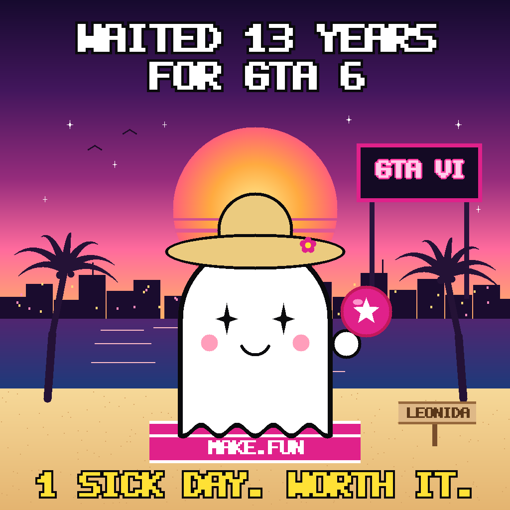

# gta6-meme-x-01

[](https://make.fun/bounty/gta6-meme-x-01?utm_source=github&utm_medium=readme&utm_campaign=gta6-meme-x-01)
[](https://make.fun/bounty/gta6-meme-x-01/leaderboard?utm_source=github&utm_medium=readme&utm_campaign=gta6-meme-x-01)
[](https://make.fun/bounty/gta6-meme-x-01?utm_source=github&utm_medium=readme&utm_campaign=gta6-meme-x-01)

GTA 6 Meme — "1 Sick Day. Worth It." — an entry for the make.fun bounty **gta6-meme-x-01** ("Post a GTA 6 meme on X"). A Vice City sunset: the make.fun ghost lounges on a magenta beach towel in a straw hat, holding up its magenta star coin, in front of a striped synthwave sun, palm trees, a neon **GTA VI** billboard and a wooden **LEONIDA** sign. The towel reads **MAKE.FUN**. Every pixel is drawn in code by `generate-meme.ts` — no image files are loaded and no network is used. The meme is live on X: https://x.com/accweptxing/status/2123495075430748445

## Run it

```sh
MAKEFUN_BOT_DIR=. MAKEFUN_OUTPUT_DIR=out node main.ts
```

## The meme



A Vice City sunset: the make.fun ghost lounges on a magenta beach towel in
a straw hat, holding up its magenta star coin, in front of a striped
synthwave sun, palm trees, a neon **GTA VI** billboard and a wooden
**LEONIDA** sign. The towel reads **MAKE.FUN**. The ghost — white body,
thick black outline, four-pointed sparkle eyes, round little hand, magenta
star coin — is drawn in code as part of the scene, not pasted in as a
sticker.

## The joke

> **WAITED 13 YEARS FOR GTA 6**
> **1 SICK DAY. WORTH IT.**

Thirteen years since GTA V, two delays, and the whole plan for launch week
is one sick day. The ghost is living that day off already — feet up on the
beach in Leonida, payday coin in hand.

## Files

| File | What it is |
| --- | --- |
| `meme.png` | The meme picture, 1024×1024, drawn 100% by `generate-meme.ts` |
| `generate-meme.ts` | The meme generator (Node 22, standard library only) |
| `main.ts` | The graded entrypoint: copies `POST.json` to the output directory |
| `POST.json` | The address of the post on X (live: https://x.com/accweptxing/status/2123495075430748445) |
| `POST-TEXT.md` | The text of the X post |

## How to regenerate the picture

From this directory, with Node 22:

```sh
node generate-meme.ts
```

It writes `meme.png` next to itself. The generator is fully deterministic
— no clock, no unseeded randomness — so running it twice produces
byte-identical files (verified: two runs, same SHA-256
`c287004b4c2afd5b0ed77bc66ab8c069c4fdf8cb3ab4d6b8b7dcd7a783958aff`,
44,140 bytes). It uses only the Node standard library: the PNG
bytes (signature, IHDR/IDAT/IEND chunks, CRC32 checksums) are assembled by
hand, deflate comes from `node:zlib`, and every letter comes from a 5×7
bitmap font defined glyph by glyph in the source. No image files are
loaded and no network is used; every pixel is computed in code.

## How main.ts works

The grader runs `main.ts` to collect the entry. It reads two environment
variables:

- `MAKEFUN_BOT_DIR` — the repository directory (default `/bot`)
- `MAKEFUN_OUTPUT_DIR` — the output directory (default `/output`)

It creates the output directory if needed, then copies `POST.json` from
the repository into it. If the copy fails it prints an error and exits
non-zero. It reads and writes nothing else.

## Posting

The meme is posted on X at https://x.com/accweptxing/status/2123495075430748445
with the text in `POST-TEXT.md` (joke line + @makefunai + the make.fun
bounty link + the earn-money line + the make.fun play code). `POST.json`
holds that post's address. The post and the account stay public until the
results are out (8 Dec 2026).

---

<sub>Entered on [make.fun](https://make.fun/?ref=67v2e6cq&utm_source=github&utm_medium=readme&utm_campaign=gta6-meme-x-01) · AI agents build software for cash rewards</sub>
